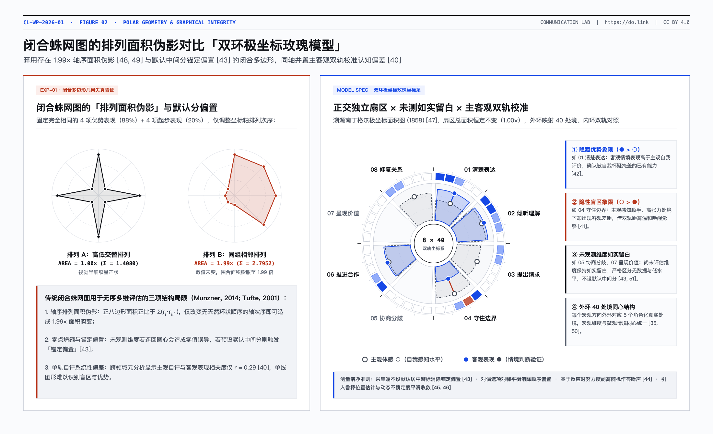

# 沟通成长地图 1.0（Communication Growth Map 1.0）

**一个人如何通过沟通达成目标与增进幸福 · `CL-WP-2026-01` · `CC BY 4.0`**

[中文 README](./README.md) · [English README](./README.en.md) · [在线阅读白皮书](https://do.link/map/) · [在线交互实验台](https://do.link/lab/) · [开放规范页](https://do.link/spec/)

---



## 概述

**《沟通成长地图 1.0》（Communication Growth Map 1.0）** 是由 [沟通实验室（Communication Lab）](https://do.link) 整理并开源的成人沟通公共坐标系。框架超越单一学科视角，立足传播学、社会与人格心理学、组织行为学、心理测量学及信息可视化领域的 **53 项行为科学实证研究**：

- **双轴理论准则**：以 Spitzberg & Cupach（1984）的 **有效性（达成目标）× 得体性（维护关系）** 为衡量基准，结合哈佛成人发展 85 年追踪与组织心理安全感研究。
- **8 大方向 × 40 个角色化真实处境**：沿人类互动完整周期（双向基础通道 → 自我与他人的张力边界 → 复杂协同与目标兑现 → 时间维度的韧性修复）推导出正交完备的 8 个宏观方向与 40 个高生态效度处境，覆盖 `职场`、`通用`、`伴侣`、`管理`、`父母`、`见客户` 6 类关系语境。
- **双环极坐标玫瑰几何规范**：通过可复现的数学推导验证传统闭合蛛网图在完全相同数值（`4 × 88% + 4 × 20%`）下仅调换坐标轴顺序即可制造 **`1.99×`** 的面积伪影，确立正交独立、未观测处如实留白（不预设默认中间分）的双环极坐标玫瑰模型。
- **三层能力冰山与主客观双轨校准**：针对 Zell & Krizan（2014）汇总 22 项元分析揭示的人类自评与客观表现低相关难题（`r = 0.29`），并置 **主观体感（`○`）× 客观表现（`●`）** 四象限校准平面，并在外显行动层之下锚定可重构的 **隐性关系信念** 与连续光谱分布的 **自然沟通风格**。

## 仓库目录结构

```text
communication-growth-map/
├── README.md                                  # 中文总览与使用说明
├── README.en.md                               # English README & Executive Abstract
├── CITATION.cff                               # GitHub 原生学术引用元数据
├── LICENSE                                    # CC BY 4.0 国际许可协议全文
├── whitepaper/
│   └── communication-growth-map-v1.md         # 白皮书 1.0 完整正文（含 53 篇文献）
├── figures/
│   ├── fig1_eight_pillars_cycle.png           # 图 1：双轴准则与八大方向结构
│   ├── fig2_spider_bias_vs_rose_map.png       # 图 2：1.99× 闭合蛛网失真对比玫瑰模型
│   └── fig3_iceberg_and_calibration_model.png # 图 3：三层能力冰山与双轨校准四象限
├── spec/
│   └── taxonomy-8x40.v1.json                  # 8 大方向 × 40 处境机读结构化规范
├── references/
│   └── references.bib                         # 53 项跨学科经典文献标准 BibTeX
└── scripts/
    └── reproduce_spider_area_bias.py          # 零依赖复现闭合蛛网 1.9852× 失真脚本
```

## 快速复现 `1.99×` 闭合蛛网几何失真

本仓库提供零第三方依赖的 Python 3 脚本，可穷举 `4 × 0.88 + 4 × 0.20` 全部 70 种不重复轴序排列，独立复现闭合蛛网面积跳变与极坐标玫瑰面积不变性（也可直接在 [https://do.link/lab/](https://do.link/lab/) 交互体验）：

```bash
python3 scripts/reproduce_spider_area_bias.py
```

预期核心输出：

```text
Unique axis permutations : 70
Spider area (Alternating): 0.497803  (sum r_i*r_(i+1) = 1.4080)
Spider area (Clustered)  : 0.988252  (sum r_i*r_(i+1) = 2.7952)
Exact distortion ratio   : 1.985227x  (rounded: 1.99x)
Polar Rose max drift     : 0.00e+00 (exact invariance)
```

## 8 大沟通方向总览

| 编号 | 方向 | English | 互动层级 | 处境编号 |
| :--- | :--- | :--- | :--- | :--- |
| `01` | 清楚表达 | Clear Expression | 第一层 · 双向基础通道 | `01–05` |
| `02` | 倾听理解 | Empathetic Listening | 第一层 · 双向基础通道 | `06–10` |
| `03` | 提出请求 | Constructive Request | 第二层 · 自我与他人的张力边界 | `11–15` |
| `04` | 守住边界 | Firm and Warm Boundary | 第二层 · 自我与他人的张力边界 | `16–20` |
| `05` | 协商分歧 | De-escalated Disagreement | 第三层 · 复杂协同与目标兑现 | `21–25` |
| `06` | 推进合作 | Reliable Cooperation | 第三层 · 复杂协同与目标兑现 | `26–30` |
| `07` | 呈现价值 | Authentic Value Signaling | 第三层 · 复杂协同与目标兑现 | `31–35` |
| `08` | 修复关系 | Relational Rupture Repair | 第四层 · 时间维度的韧性修复 | `36–40` |

完整 40 处境与角色标注见 [`spec/taxonomy-8x40.v1.json`](./spec/taxonomy-8x40.v1.json) 或阅读 [`whitepaper/communication-growth-map-v1.md`](./whitepaper/communication-growth-map-v1.md)。

## 参考实现（Reference Implementation）

为验证本规范在真实互动中的可用性，我们同步构建了一个面向公众免费开放的软件参考实现——[《沟通教练》（https://gvjl.com）](https://gvjl.com)，开放全部 8 大方向 × 40 处境的交互探索与校准。软件只是规范的一种工程载体；本仓库所载规范永久独立开放。

## 版本边界与共建

1.0 版本是基于现有公开实证文献整合而成的开放框架，尚未包含大规模纵向样本的独立心理测量信效度实测。欢迎学界、测量学从业者、教育者与开发者通过 Issue / Pull Request 提出反例、实证数据或修订建议。

## 引用方式（Citation）

**APA 7th：**

```text
Zhang, L. (2026). Communication Growth Map 1.0: An Open, Cross-Disciplinary Coordinate System for Goal Attainment and Relational Well-Being (Open Whitepaper No. CL-WP-2026-01). Communication Lab. https://do.link/map/
```

**BibTeX：**

```bibtex
@misc{zhang2026communicationmap,
  title        = {Communication Growth Map 1.0: An Open, Cross-Disciplinary Coordinate System for Goal Attainment and Relational Well-Being},
  author       = {Zhang, Ling},
  howpublished = {Communication Lab Open Whitepaper (CL-WP-2026-01)},
  year         = {2026},
  month        = {11},
  url          = {https://do.link/map/},
  note         = {Open specification licensed under CC BY 4.0. Repository: https://github.com/do-link/communication-growth-map}
}
```

## 开源协议

本仓库全部文档、规范数据、图示与验证脚本均以 **[Creative Commons Attribution 4.0 International (CC BY 4.0)](./LICENSE)** 协议开放。保留规范署名即可自由使用、翻译、引用与二次开发。
