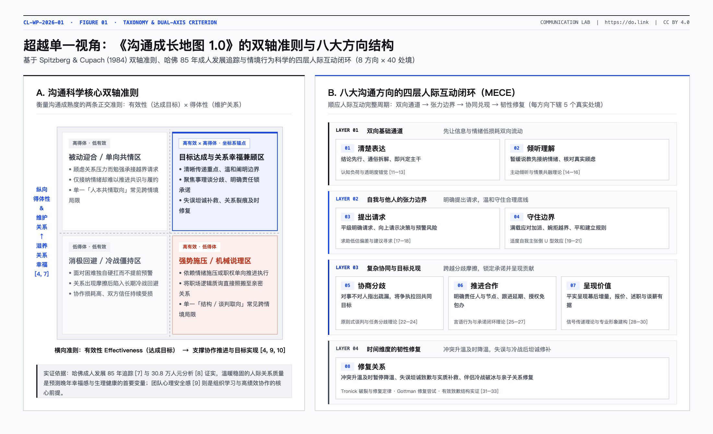
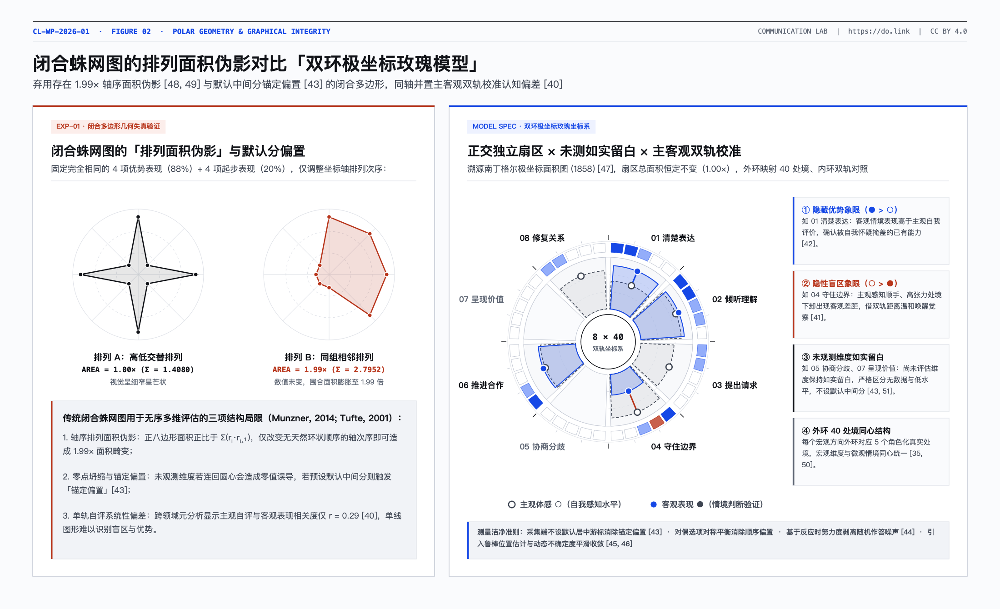
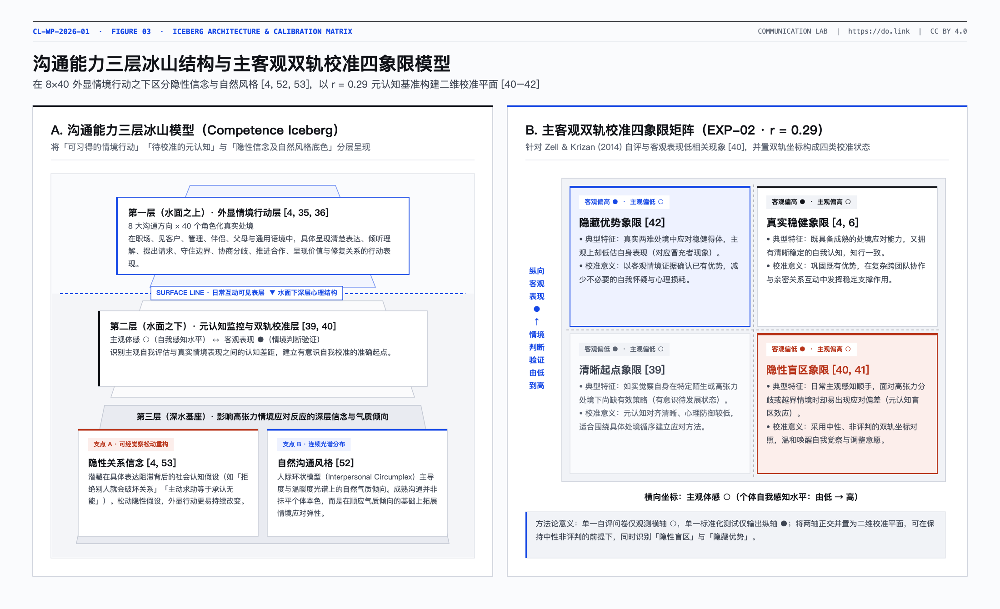

# 沟通成长地图 1.0：一个人如何通过沟通达成目标与增进幸福

**——超越单一学科视角、基于 53 项行为科学实证研究的成人沟通开放坐标系**

| 元数据项 | 内容 | 元数据项 | 内容 |
| :--- | :--- | :--- | :--- |
| **文档编号** | `CL-WP-2026-01` | **版本与日期** | Version 1.0（2026 年 11 月） |
| **整理与执笔** | 张零（Zhang Ling） | **发布渠道** | 沟通实验室（https://do.link） |
| **文献核验** | 53 项跨学科实证研究 | **开源协议** | `CC BY 4.0 International` |
| **在线白皮书** | https://do.link/map/ | **交互实验台** | https://do.link/lab/ |
| **开放规范与复现代码** | https://do.link/spec/ | **开源仓库** | https://github.com/do-link/communication-growth-map |

---

## 摘要（Abstract）

在生成式人工智能已经能够快速起草发言稿、润色商务邮件与生成结构化分析报告的今天，人类在真实关系现场的面对面沟通能力非但没有贬值，反而成为决定个体协作效能与长期幸福感的关键能力 `[7, 10]`。然而，长期以来成人沟通研究与大众实践面临三重结构性局限：**单一视角分割**（结构表达、人本共情、冲突谈判等研究传统各自聚焦特定环节，难以单独覆盖跨情境需求）、**脱离处境的笼统特质打分**（跨情境抽象特质对具体行为的预测相关系数普遍低于 $0.30$）`[34, 35]`，以及**自我认知的系统性偏差**（跨领域元分析显示人类主观自评与客观表现的平均相关系数仅为 $r = 0.29$）`[40]`。

本文正式发布并开源 **《沟通成长地图 1.0》（Communication Growth Map 1.0）**。该框架立足公开实证文献，借助多智能体（AI Agents）的跨学科文献梳理、边界反例核查与数学脚本验证能力，将近半个世纪传播学、社会与人格心理学、组织行为学、心理测量学及信息可视化领域的 **53 项经典实证研究** 与中文现实沟通场景进行了系统整合。框架超越单一学科与学派视角，以人际传播学公认的「有效性（达成目标）× 得体性（维护关系）」双轴准则为基石 `[4]`，构建了 **8 大沟通方向 × 40 个高生态效度真实处境** 的四层人际互动闭环；在视觉几何与心理测量结构上，通过可复现的数学推导弃用存在 `1.99×` 轴序排列面积伪影与默认中间分锚定偏置的传统闭合蛛网图 `[43, 48, 49]`，确立了 **「双环极坐标玫瑰模型」** 与 **「沟通能力三层冰山及主客观双轨校准四象限模型」** `[40, 41, 42, 52, 53]`。本框架规范以 `CC BY 4.0` 协议开放共享，欢迎学界同行与公众检验。

- **公开发布地址**：沟通实验室白皮书专页（https://do.link/map/）、交互实验台（https://do.link/lab/）、开放规范页（https://do.link/spec/）与开源组织仓库（https://github.com/do-link/communication-growth-map）。

---

## 引言：为什么需要一张超越单一视角的公共沟通坐标系？

当生成式人工智能在几秒内就能写出一封措辞得体的邮件、一份条理清晰的汇报提纲时，人类为什么依然需要认真研究沟通？

答案藏在机器无法代劳的“面对面实时互动”里：会议室里被突然追问时的即时回应、面对越界请求时的温和设界、绩效面谈中兼顾标准与尊重的分寸，以及亲密关系僵局里主动修补裂痕的诚意。哈佛大学经济学家 David Deming 对近四十年劳动力市场的实证分析表明：随着自动化与计算能力不断增强，纯标准化认知任务的溢价持续走低，而**高认知判断与高人际协同相结合的能力，成为回报曲线最陡峭的稀缺能力** `[10]`。

与此同时，AI Agent 辅助研究工具的成熟，也显著降低了跨学科知识梳理与交叉核验的门槛。借助多智能体的文献检索、概念边界反例核查与数学验证脚本编写，来自一线实践的真实沟通问题如今能够更系统地与过去半个世纪各学科的公开实证文献逐一比对、接受可复现检验，而不必停留在零散的个人经验归纳层面。

长期以来，大众沟通读物与培训往往各自聚焦单一维度——重结构者强调金字塔逻辑，重共情者强调非暴力倾听，重博弈者聚焦谈判桌策略。但面对一个成年人在职场、协作与家庭中的完整互动周期，没有任何单一方法论传统能够独自覆盖全部情境规律。在具体的话术与技巧之前，研究与实践首先需要的是**一张中立、基于实证、可公开核验的公共沟通坐标系**。

> 因此，《沟通成长地图 1.0》在设计上不局限于任何单一学派视角（包括执笔者过往的方法论著作）。每一项方向划分、图形选择与测量规范，均以正文所列的 53 篇公开实证文献与可复现的数学推导为依据，欢迎学界与实践者提出反例与修订意见。

---

## 第一章：为什么我们需要一张新地图？——传统沟通认知与评估的三项局限

在日常工作与亲密关系中，个体即便掌握了大量通用表达技巧，面对高张力现实互动时仍常出现知行脱节。从行为科学与心理测量学的视角审视，传统沟通认知与评估方式主要存在三项结构性局限：

### 1. 单一方法论取向的局部有效与跨情境失灵

既有大众沟通方法在传播中常演变为彼此分离的单一视角：

- **结构表达取向**（如金字塔原理 `[12]`）在处理职场汇报、信息对齐时清晰高效，但若直接照搬至亲密关系中处理伴侣的情绪倾诉，往往适得其反；
- **人本共情取向**（如主动倾听 `[14]` 与非暴力沟通）擅长降低防御与建立安全感，但在职责模糊的跨部门推进或底线明确的商业合作中，仅有温和共情难以锁定履约承诺与合理边界；
- **冲突与谈判取向**（如原则式谈判 `[22]`）聚焦高张力利益协调，却较少覆盖日常预期对齐、隐性贡献呈现与长期关系裂痕修复。

真实的人际生活是一个连续整体。同一人在同一天内往往需要跨越汇报、设界、协同跟进与家庭修复等多重语境；缺少整合性的全景坐标系，实践者便容易在局部技巧之间顾此失彼。

### 2. 脱离具体处境与关系角色的「笼统特质打分」缺乏预测效度

不少传统沟通测评依赖脱离具体背景的抽象自陈量表，向受测者输出一个笼统的“沟通力总分”。

这一评估方式在行为科学上存在明显的效度局限。哥伦比亚大学心理学家 Walter Mischel（1968）指出，跨情境抽象人格特质对个体具体真实行为的预测相关系数普遍不超过 $0.30$ `[34]`；Mischel 与 Shoda（1995）提出的**「认知-情感加工系统（CAPS）」**进一步证实，个体的真实能力结构是由一系列 `在特定情境 X 下 → 触发何种反应 Y` 的条件特征谱构成的 `[35]`。Harry Reis（2008）亦系统论证，人际情境的核心在于其**关系结构与功能可供性（Affordances）**——同一人在面对上级、客户、下属、伴侣与年幼子女时，激活的是截然不同的社会规范与互动图式 `[36]`。**脱离具体情境与关系角色给出笼统的“沟通力总分”，在心理测量学上缺乏足够的预测效度与生态效度。**

### 3. 单轨主观自评的系统性偏差：元认知失准掩盖真实盲区与优势

在生成式 AI 让通用表达模板随手可得的当下，真正的成长瓶颈往往不在于缺少标准话术，而在于缺少**对自身真实沟通处境与认知盲区的准确元认知觉察** `[39]`。

心理学家 Ethan Zell 与 Zlatan Krizan（2014）汇总 22 项大型元分析完成的“元-元分析（Metasynthesis）”表明：**人类主观自我评估与客观实际表现之间的平均相关系数仅为 $r = 0.29$** `[40]`。这意味着，仅依赖单轨主观自评问卷绘制的能力画像，有逾七成方差受自我认知偏差干扰——部分受测者因元认知盲区高估自身表现 `[41]`，另一部分实际表现稳健者则因冒充者现象过度自我苛责 `[42]`。要建立可靠的成长起点，评估框架必须扎根具体真实处境，并引入主客观双轨校准机制。

---

## 第二章：理论基石——沟通如何影响一个人的目标达成与关系幸福？

剥离表面修辞，个体在社会与关系网络中的沟通实践主要指向两个核心维度：**向外协同他人达成目标**，**向内维护关系并增进幸福**。三条跨学科理论基石共同构成了本框架的底层支撑：

1. **人际沟通能力（ICC）的「有效性 × 得体性」双轴准则**：
   自社会语言学家 Dell Hymes（1972）提出“交际能力（Communicative Competence）”概念 `[1]`，经 Wiemann（1977）`[2]` 与 Rubin（1982）`[3]` 奠定行为评估基础，Spitzberg 与 Cupach（1984）确立了人际传播学沿用至今的核心**双轴准则** `[4, 5]`——成熟的沟通行为需同时满足两条正交标尺：
   - **有效性（Effectiveness，达成目标）**：在特定互动中清晰传递意图、协调分歧、推动承诺落地并实现预期目标；
   - **得体性（Appropriateness，维护关系）**：在达成目标的过程中尊重情境规范、顾及他人尊严、维护关系信任，同时守住自身合理边界而不自我透支。
2. **跨越 85 年的人类终身幸福与健康实证**：
   哈佛大学成人发展研究（Waldinger & Schulz, 2023）追踪数代人长达八十五年证实，预测个体晚年幸福感、心理韧性与生理健康水平的最强单一变量，是人际关系的温暖度与安全感 `[7]`；Holt-Lunstad 等人（2010）涵盖 148 项独立研究、308,849 名受试者的医学元分析进一步证实，稳固和谐的社会连接可将长期生存概率提升 50% `[8]`。得体而真诚的沟通，正是高质量关系得以建立与维系的日常机制。
3. **组织高绩效协作与能力可塑性基石**：
   Edmondson（1999）的实证研究揭示，团队学习与高绩效复杂协作首要依赖成员敢于坦诚报忧、直面专业分歧的**心理安全感** `[9]`；Hargie（2022）综合数十年社会技能研究证明，沟通能力并非固定不变的先天禀赋，而是一套可按情境拆解并持续习得精进的行动体系 `[6]`。

---

## 第三章：全景解构——《沟通成长地图 1.0》的 8 大方向与 40 个真实处境

沿着人类社会互动从发生、深化到修复的完整周期——**「信息与情绪双向流动 → 自我与他人边界确立 → 复杂事务跨分歧协同兑现 → 关系受损后修补愈合」**——可推导出正交完备（MECE）的 **8 大宏观方向** 与 **40 个微观处境**：

### 1. 八大沟通方向的四层人际互动闭环

#### 第一层 · 双向基础通道：把话讲清，把人听懂
- **01 清楚表达（Clear Expression）**：基于 Sweller（1988）认知负荷理论 `[11]`、Minto（2009）结构化表达原则 `[12]` 与 Keysar & Henly（2002）说话者“透明度错觉”实验 `[13]`，核心在于开口前先立主干、分清主次，降低听者的工作记忆负荷，减少高估对方听懂潜台词的概率。
- **02 倾听理解（Empathetic Listening）**：基于 Rogers & Farson（1957）主动倾听 `[14]`、Weger 等人（2014）核对式倾听对照实验 `[15]` 与 Kluger & Itzchakov（2022）情景共融理论 `[16]`，要求暂缓反驳与说教冲动，先接纳字面背后的情绪张力，再核对真实顾虑与期待。

#### 第二层 · 自我与他人的张力边界：明确提出请求，温和守住边界
- **03 提出请求（Constructive Request）**：Flynn & Lake（2008）证实求助者常低估他人施援意愿近 50% `[17]`，Brooks 等人（2015）证实带着清晰背景与备选建议主动请教反而显著提升胜任力评价 `[18]`。核心是用明确范围与可行选项替代含糊试探或独自硬扛。
- **04 守住边界（Firm and Warm Boundary）**：立于被动迎合与攻击爆发之间的适度自我主张区间 `[19]`，遵循 Ames & Flynn（2007）主张强度倒 U 型效应 `[20]` 与 Patrick & Hagtvedt（2012）原则式拒绝研究 `[21]`，基于清晰负荷底线提出可执行替代方案。

#### 第三层 · 复杂协同与目标兑现：化分歧为共识，让贡献可识别
- **05 协商分歧（De-escalated Disagreement）**：结合原则式谈判 `[22]` 以及 Jehn（1995）、De Dreu & Weingart（2003）冲突元分析 `[23, 24]`，严格保护聚焦事理的「任务分歧」，阻断滑向人身指责的「关系冲突」，将讨论重新锚定在共同目标上。
- **06 推进合作（Reliable Cooperation）**：源于 Austin（1962）言语行为理论 `[25]`、Winograd & Flores（1986）语言/行动视角 `[26]` 与团队过程分类学 `[27]`，以清晰承诺锁定请求、验收标准、责任人与时间节点，消除职责模糊地带与事必躬亲的包办代劳。
- **07 呈现价值（Authentic Value Signaling）**：基于 Spence（1973）信号传递理论 `[28]`、Roberts（2005）专业形象建构研究 `[29]` 与谈判议价自我设限研究 `[30]`，克服信息不对称与自我折价，用客观可核验的结果语言平实呈现隐性投入带来的增量与风险防范。

#### 第四层 · 时间维度的韧性修复：冲突能降温，裂痕能弥合
- **08 修复关系（Relational Rupture Repair）**：立足 Tronick（1989）破裂与修复定律 `[31]`、Gottman（1999）修复尝试纵向追踪 `[32]` 与 Lewicki 等人（2016）有效致歉结构实证 `[33]`——长期关系的韧性并非源于零摩擦，而源于冲突升温时及时暂停降温，并发出与接纳坦诚、具体的实质修复信号。

---

### 2. 四十个情境化、角色化的原子切面（Situational Taxonomy）

依据 CAPS 理论 `[35]`、关系语境理论 `[36]` 与情境判断测验（SJT）效度准则 `[37, 38]`，全图在 6 类关系角色语境（`职场 22`、`通用 6`、`伴侣 4`、`管理 3`、`父母 3`、`见客户 2`）下锚定 **40 个高频真实处境**（完整机读结构见 `https://do.link/spec/`）：

| 宏观方向 | 对目标达成与关系幸福的核心价值 | 下辖 5 个核心情境切面（编号 `01`–`40` 及角色语境） |
| :--- | :--- | :--- |
| **01 清楚表达** `Expression` | 汇报对齐减少返工 · 降低反复解释损耗 · 当众表达清晰从容 | `01` 结论先行与限时简明汇报 *(职场)* · `02` 复杂方案通俗化拆解 *(职场)* · `03` 发散讨论归纳与收敛共识 *(职场)* · `04` 当众即兴发言与应对追问 *(职场)* · `05` 慢热场合自然接话 *(通用)* |
| **02 倾听理解** `Listening` | 滋养亲密关系安全感 · 准确把握协作需求 · 建立长期信任基础 | `06` 暂缓说教先接纳情绪 *(通用)* · `07` 听出异议背后的真实顾虑 *(职场)* · `08` 承接模糊指令与澄清预期 *(职场)* · `09` 应对伴侣抱怨与重提往事 *(伴侣)* · `10` 读懂孩子沉默与抵触 *(父母)* |
| **03 提出请求** `Request` | 明确协同突破个体局限 · 减少家庭隐性怨怼 · 提前预警关键风险 | `11` 平级协作明确提出请求 *(职场)* · `12` 向上请示决策与备选建议 *(职场)* · `13` 项目风险提前预警与补救 *(职场)* · `14` 熟人账目厘清与日常求助 *(通用)* · `15` 伴侣家务与财务坦诚商量 *(伴侣)* |
| **04 守住边界** `Boundary` | 守护核心精力与专注度 · 避免被动迎合与积怨 · 以清晰原则赢得尊重 | `16` 负荷满载时稳妥应对临时加派 *(职场)* · `17` 婉拒熟人借钱与隐私打探 *(通用)* · `18` 范围外免费要求转正式增购 *(见客户)* · `19` 合作顺畅期温和阐明原则底线 *(职场)* · `20` 平和坚定地建立育儿规则 *(父母)* |
| **05 协商分歧** `Disagreement` | 坦诚建言提升决策质量 · 避免家庭分歧激化升级 · 在碰撞中深化互信 | `21` 将争执输赢拉回共同目标 *(职场)* · `22` 对事不对人地指出疏漏与标准 *(职场)* · `23` 向上提出不同专业判断 *(职场)* · `24` 伴侣消费观与原生家庭分歧 *(伴侣)* · `25` 绩效面谈与资深成员预期对齐 *(管理)* |
| **06 推进合作** `Cooperation` | 积累可靠履约信用 · 避免事必躬亲与包办代劳 · 降低交付前协作摩擦 | `26` 会议收尾明确责任人与时间节点 *(职场)* · `27` 跟进协作延期与推进交付 *(职场)* · `28` 跨组交接与变动同步 *(职场)* · `29` 清晰委派授权与避免包办代劳 *(管理)* · `30` 团队例会聚焦与跨部门协同支持 *(管理)* |
| **07 呈现价值** `Value` | 述职报价谈薪回报匹配 · 平实确认自身专业贡献 · 促进双向对等合作 | `31` 平实呈现幕后投入与业务增量 *(职场)* · `32` 清晰阐述报价依据与应对比较 *(见客户)* · `33` 谈薪议价与晋升答辩 *(职场)* · `34` 专业自我介绍与合作价值呈现 *(通用)* · `35` 阶段性成果预期管理 *(职场)* |
| **08 修复关系** `Repair` | 增强伴侣与亲子关系韧性 · 职场失误坦诚止损补救 · 减少事后反刍内耗 | `36` 冲突升温时及时暂停与降温 *(通用)* · `37` 失误坦诚致歉与实质补救 *(职场)* · `38` 争执或受批后自然破冰 *(职场)* · `39` 伴侣冷战破冰与坦诚致歉 *(伴侣)* · `40` 对孩子情绪失控后的关系修复 *(父母)* |

---

## 第四章：视觉表征与双轨校准——几何图形与心理测量设计

一套严谨的评估框架，不仅取决于其分类维度，也取决于其如何如实表征多维数据与认知不确定性。本框架基于信息可视化、心理测量学与人格结构研究，确立了三项核心模型规范：

### 1. 为什么弃用「闭合蛛网图」，采用「双环极坐标玫瑰模型」？

Edward Tufte `[48]` 与 Tamara Munzner（2014）`[49]` 指出了传统闭合蛛网雷达图（Spider / Radar Chart）用于无序多维能力评估时的两项结构性局限：

- **第一，高达 `1.99×` 的「轴序排列面积伪影」**：闭合蛛网图将相邻坐标轴上的点连线成网，正八边形围合面积由公式 $\frac{1}{2}\sin(45^\circ)\sum_{i=1}^{8} r_i r_{i+1}$ 决定。对固定分布 `4 × 88% + 4 × 20%` 而言，仅改变无天然环状顺序的坐标轴排列次序，相邻乘积和 $\sum r_i r_{i+1}$ 即可从高低交替排列的 `1.4080`（基准面积 `1.00×`）跃升至同组相邻排列的 `2.7952`（面积膨胀至 **`1.99×`**，在线交互实验见 `https://do.link/lab/`）。
- **第二，未观测维度的「零点坍缩」与「默认中间分锚定偏置」**：当部分维度尚无观测数据时，闭合蛛网图为了连线闭合，要么将未知维度拉回圆心零点造成视觉残缺，要么预设默认中间分——从而直接触发 Tversky & Kahneman（1974）所证实的**锚定偏置（Anchoring Bias）** `[43]`。

为此，《沟通成长地图 1.0》溯源南丁格尔极坐标面积图（1858）`[47]` 与径向层级空间可视化原理 `[50]`，确立 **「双环极坐标玫瑰模型」**：8 个扇区正交独立生长，无论如何调整扇区排列次序，总面积恒定不变（`1.00×`）；外环映射 40 个真实处境，内环并置主客观双轨水平。鉴于人类认知对未闭合图形天然具有完形关注倾向 `[51]`，尚未观测的扇区保持如实留白（未测留白），严格区分“尚无观测数据”与“能力偏低”，不为未知维度预设默认中间分 `[43]`。

### 2. 「主观体感 `○` × 客观表现 `●`」双轨校准四象限与测量洁净准则

针对 Zell & Krizan（2014）揭示的主观自评与客观表现低相关现象（$r = 0.29$）`[40]`，本模型在每个方向与情境节点并置**主观体感（`○`）**与**客观表现（`●`）**，构成四个具有明确心理学意义的校准象限：

1. **隐藏优势象限（客观偏高 `●` · 主观偏低 `○`）**：对应冒充者现象 `[42]`，以客观情境判断证据帮助受测者确认已有能力，缓解不必要的自我怀疑；
2. **隐性盲区象限（客观偏低 `●` · 主观偏高 `○`）**：对应元认知盲区效应 `[41]`，采用中性、非评判的方式呈现双轨坐标差距，温和唤醒自我觉察；
3. **真实稳健象限（客观偏高 `●` · 主观偏高 `○`）**：主观感知与客观处境表现一致的稳健状态 `[4, 6]`；
4. **清晰起点象限（客观偏低 `●` · 主观偏低 `○`）**：元认知觉察清晰、心理防御较低的有意识待发展状态 `[39]`。

框架同时规定四条**底层测量洁净准则**：① 采集端不设默认居中游标以消除锚定偏置 `[43]`；② 对偶情境选项实施位置对称平衡以消除顺序偏置；③ 基于反应时努力度模型剥离低注意力随机作答噪声 `[44]`；④ 引入鲁棒位置估计与动态不确定度更新机制，使个体画像对偶发波动具备统计稳健性并随新证据平滑收敛 `[45, 46]`。

### 3. 沟通能力三层冰山模型：隐性关系信念与自然沟通风格

依据 Spitzberg & Cupach（1984）的技能—知识—意愿三元结构 `[4]`，本框架在 `8 × 40` 外显情境行动层与元认知双轨校准层之下，进一步区分深层心理结构的双重底色：

- **隐性关系信念（Implicit Relational Beliefs，可经觉察松动重构）**：基于 Dweck & Leggett（1988）社会认知模型 `[53]`，识别潜藏在具体表达阻滞背后的隐性社会认知假设（如“拒绝别人就会破坏关系”、“主动求助等于承认无能”）；
- **自然沟通风格（Natural Communication Style，连续光谱分布）**：基于 Wiggins（1979）人际环状模型（Interpersonal Circumplex）`[52]`，尊重个体在主导度与温暖度光谱上的自然气质倾向，在顺应个体本色的基础上拓展跨情境应对弹性。

---

## 第五章：构建方法与版本边界——公开文献 × 现实处境 × AI Agent 核验

为避免将公共框架简化为个人经验归纳，或流于缺乏情境锚点的泛化分类，本版本在整理与校验过程中采取了三层工作机制：

1. **文献锚定层（以同行评议实证文献为基准）**：全部顶层双轴准则、情境效度原则、认知偏误边界与图形可视化规范，均直接追溯至传播学、社会与人格心理学、组织行为学、心理测量学及信息可视化领域的 53 项经典学术文献。
2. **多智能体核验层（概念边界核查与数学可复现）**：借助多智能体（AI Agents）交叉核查 8 大方向之间的正交性与覆盖边界，编写零第三方依赖的 Python 穷举验证脚本复现闭合蛛网 `1.99×` 面积伪影与极坐标玫瑰面积不变性（见 `https://do.link/spec/#proof` 与开源仓库），并对全部参考文献逐条核验原始出处。
3. **现实处境与表达约束层（中文语境高生态效度）**：结合长期一线观察案例，将抽象理论构念落位于 40 个具体的中文职场、商业与家庭互动处境中，坚持中性、非评判的情境命名与描述，不为未观测维度预设默认中间分。

**版本边界与开放修订**：1.0 版本是基于现有公开实证文献整合而成的开放理论与评估规范框架，尚未包含大规模纵向样本的独立心理测量信效度实测。欢迎学界研究者、测量学从业者与开发者通过 GitHub（https://github.com/do-link/communication-growth-map）提出反例、实证检验数据与修订建议，共同推动后续版本演进。

---

## 结语：开源协议、参考实现与作者简介

我们将《沟通成长地图 1.0》的全部核心规范（含白皮书全文、`8×40` 机读分类 JSON、53 篇 BibTeX 文献库与几何复现脚本）以 **CC BY 4.0（Creative Commons Attribution 4.0 International）** 开源发布于沟通实验室（https://do.link/spec/）与 GitHub（https://github.com/do-link/communication-growth-map）。任何研究者、教育者、组织顾问与开发者，只要保留规范署名，均可自由引用、演绎并构建自己的工具。

> **关于参考实现（Reference Implementation）的说明**  
> 为检验本规范在真实互动中的可用性，我们同步构建了一个面向公众免费开放的软件参考实现——[《沟通教练》（https://gvjl.com）](https://gvjl.com)，开放全部 8 大方向 × 40 处境的交互探索与校准。软件只是规范的一种工程载体；《沟通成长地图 1.0》本身作为公开知识规范永久独立开放。

### 作者简介

**张零（Zhang Ling）**，高情商沟通与沟通实验室发起人。自 2013 年起从事中文人际沟通的一线观察与教学实践，2016 年创立高情商沟通，2018 年成立公司，2020 年与 2025 年先后出版两版原创方法论著作《极简沟通》。

---

## 参考文献（共 53 项）

1. Hymes, D. H. (1972). On communicative competence. In J. B. Pride & J. Holmes (Eds.), *Sociolinguistics: Selected readings* (pp. 269–293). Penguin Books.
2. Wiemann, J. M. (1977). Explication and test of a model of communicative competence. *Human Communication Research*, 3(3), 195–213.
3. Rubin, R. B. (1982). *Assessing communication competency: An introduction* (ERIC Document Reproduction Service No. ED225215). Speech Communication Association.
4. Spitzberg, B. H., & Cupach, W. R. (1984). *Interpersonal communication competence*. Sage Publications.
5. Spitzberg, B. H. (2013). (Re)introducing communication competence to the health professions. *Journal of Public Health Research*, 2(3), e23.
6. Hargie, O. (2022). *Skilled interpersonal communication: Research, theory and practice* (8th ed.). Routledge.
7. Waldinger, R., & Schulz, M. (2023). *The good life: Lessons from the world's longest scientific study of happiness*. Simon & Schuster.
8. Holt-Lunstad, J., Smith, T. B., & Layton, J. B. (2010). Social relationships and mortality risk: A meta-analytic review. *PLoS Medicine*, 7(7), e1000316.
9. Edmondson, A. (1999). Psychological safety and learning behavior in work teams. *Administrative Science Quarterly*, 44(2), 350–383.
10. Deming, D. J. (2017). The growing importance of social skills in the labor market. *The Quarterly Journal of Economics*, 132(4), 1593–1640.
11. Sweller, J. (1988). Cognitive load during problem solving: Effects on learning. *Cognitive Science*, 12(2), 257–285.
12. Minto, B. (2009). *The pyramid principle: Logic in writing and thinking* (3rd ed.). Pearson Education.
13. Keysar, B., & Henly, A. S. (2002). Speakers' overestimation of their effectiveness. *Psychological Science*, 13(3), 207–212.
14. Rogers, C. R., & Farson, R. E. (1957). *Active listening*. Industrial Relations Center, University of Chicago.
15. Weger, H., Jr., Bell, G. C., Minei, E. M., & Robinson, M. C. (2014). The relative effectiveness of active listening in initial interactions. *International Journal of Listening*, 28(1), 13–31.
16. Kluger, A. N., & Itzchakov, G. (2022). The power of listening at work. *Annual Review of Organizational Psychology and Organizational Behavior*, 9(1), 121–146.
17. Flynn, F. J., & Lake, V. K. B. (2008). If you need help, just ask: Underestimating compliance with direct requests for help. *Journal of Personality and Social Psychology*, 95(1), 128–143.
18. Brooks, A. W., Gino, F., & Schweitzer, M. E. (2015). Smart people ask for (my) advice: Seeking advice boosts perceptions of competence. *Management Science*, 61(6), 1421–1435.
19. Alberti, R. E., & Emmons, M. L. (1970). *Your perfect right: A guide to assertive behavior*. Impact Publishers.
20. Ames, D. R., & Flynn, F. J. (2007). What breaks a leader: The curvilinear relation between assertiveness and leadership. *Journal of Personality and Social Psychology*, 92(2), 307–324.
21. Patrick, V. M., & Hagtvedt, H. (2012). "I don't" versus "I can't": When empowered refusal motivates goal-directed behavior. *Journal of Consumer Research*, 39(2), 371–381.
22. Fisher, R., Ury, W. L., & Patton, B. (2011). *Getting to yes: Negotiating agreement without giving in* (3rd ed.). Penguin Books. (Original work published 1981)
23. Jehn, K. A. (1995). A multimethod examination of the benefits and detriments of intragroup conflict. *Administrative Science Quarterly*, 40(2), 256–282.
24. De Dreu, C. K. W., & Weingart, L. R. (2003). Task versus relationship conflict, team performance, and team member satisfaction: A meta-analysis. *Journal of Applied Psychology*, 88(4), 741–749.
25. Austin, J. L. (1962). *How to do things with words*. Oxford University Press.
26. Winograd, T., & Flores, F. (1986). *Understanding computers and cognition: A new foundation for design*. Ablex.
27. Marks, M. A., Mathieu, J. E., & Zaccaro, S. J. (2001). A temporally based framework and taxonomy of team processes. *Academy of Management Review*, 26(3), 356–376.
28. Spence, M. (1973). Job market signaling. *The Quarterly Journal of Economics*, 87(3), 355–374.
29. Roberts, L. M. (2005). Changing faces: Professional image construction in diverse organizational settings. *Academy of Management Review*, 30(4), 685–711.
30. Amanatullah, E. T., & Morris, M. W. (2010). Negotiating gender roles: Gender differences in assertive negotiating are mediated by women's fear of backlash and attenuated when negotiating on behalf of others. *Journal of Personality and Social Psychology*, 98(2), 256–267.
31. Tronick, E. Z. (1989). Emotions and emotional communication in infants. *American Psychologist*, 44(2), 112–119.
32. Gottman, J. M. (1999). *The marriage clinic: A scientifically based marital therapy*. W. W. Norton & Company.
33. Lewicki, R. J., Polin, B., & Lount, R. B., Jr. (2016). An exploration of the structure of effective apologies. *Negotiation and Conflict Management Research*, 9(2), 177–196.
34. Mischel, W. (1968). *Personality and assessment*. John Wiley & Sons.
35. Mischel, W., & Shoda, Y. (1995). A cognitive-affective system theory of personality: Reconceptualizing situations, dispositions, dynamics, and invariance in personality structure. *Psychological Review*, 102(2), 246–268.
36. Reis, H. T. (2008). Reinvigorating the concept of situation in social psychology. *Personality and Social Psychology Review*, 12(4), 311–329.
37. McDaniel, M. A., Finnegan, E. B., Braverman, E. P., Morgeson, F. P., & Campion, M. A. (2001). Use of situational judgment tests to predict job performance: A clarification of the literature. *Journal of Applied Psychology*, 86(4), 730–740.
38. Lievens, F., & Sackett, P. R. (2012). The validity of interpersonal skills assessment via situational judgment tests for predicting academic success and job performance. *Journal of Applied Psychology*, 97(2), 460–468.
39. Flavell, J. H. (1979). Metacognition and cognitive monitoring: A new area of cognitive–developmental inquiry. *American Psychologist*, 34(10), 906–911.
40. Zell, E., & Krizan, Z. (2014). Do people have insight into their abilities? A metasynthesis. *Perspectives on Psychological Science*, 9(2), 111–125.
41. Kruger, J., & Dunning, D. (1999). Unskilled and unaware of it: How difficulties in recognizing one's own incompetence lead to inflated self-assessments. *Journal of Personality and Social Psychology*, 77(6), 1121–1134.
42. Clance, P. R., & Imes, S. A. (1978). The imposter phenomenon in high achieving women: Dynamics and therapeutic intervention. *Psychotherapy: Theory, Research & Practice*, 15(3), 241–247.
43. Tversky, A., & Kahneman, D. (1974). Judgment under uncertainty: Heuristics and biases. *Science*, 185(4157), 1124–1131.
44. Wise, S. L., & Kong, X. (2005). Response time effort: A new measure of examinee motivation in computer-based tests. *Applied Measurement in Education*, 18(2), 163–183.
45. Huber, P. J. (1964). Robust estimation of a location parameter. *The Annals of Mathematical Statistics*, 35(1), 73–101.
46. Glickman, M. E. (2001). Dynamic paired comparison models with stochastic variances. *Journal of Applied Statistics*, 28(6), 673–689.
47. Nightingale, F. (1858). *Notes on matters affecting the health, efficiency, and hospital administration of the British Army*. Harrison and Sons.
48. Tufte, E. R. (2001). *The visual display of quantitative information* (2nd ed.). Graphics Press.
49. Munzner, T. (2014). *Visualization analysis and design*. CRC Press.
50. Stasko, J., Catrambone, R., Guzdial, M., & McDonald, K. (2000). An evaluation of space-filling information visualizations for depicting hierarchical structures. *International Journal of Human-Computer Studies*, 53(5), 663–694.
51. Zeigarnik, B. (1927). Das Behalten erledigter und unerledigter Handlungen. *Psychologische Forschung*, 9, 1–85.
52. Wiggins, J. S. (1979). A psychological taxonomy of trait-descriptive terms: The interpersonal domain. *Journal of Personality and Social Psychology*, 37(3), 395–412.
53. Dweck, C. S., & Leggett, E. L. (1988). A social-cognitive approach to motivation and personality. *Psychological Review*, 95(2), 256–273.
